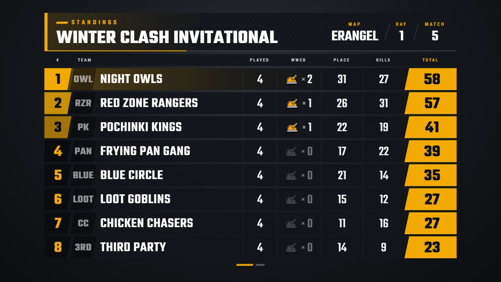
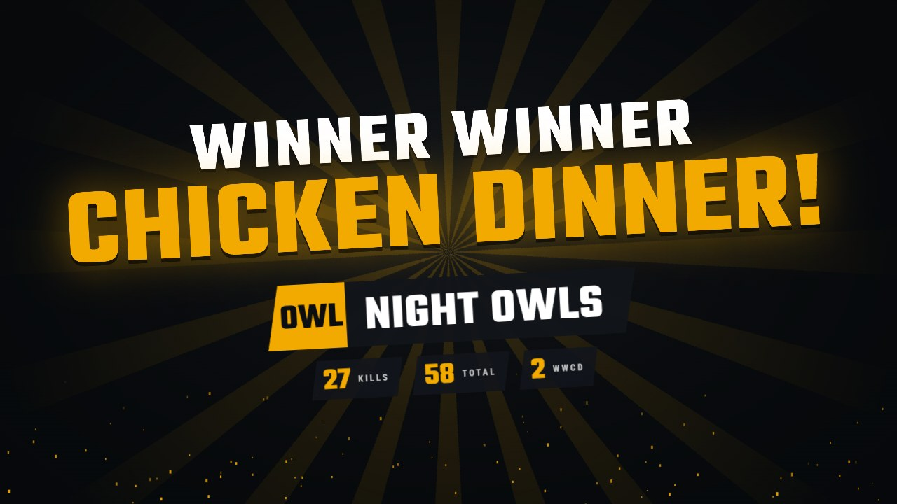
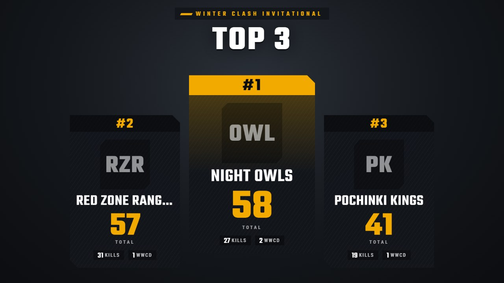
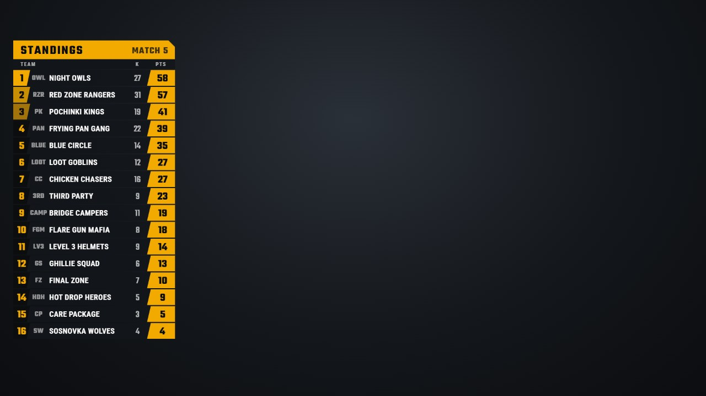
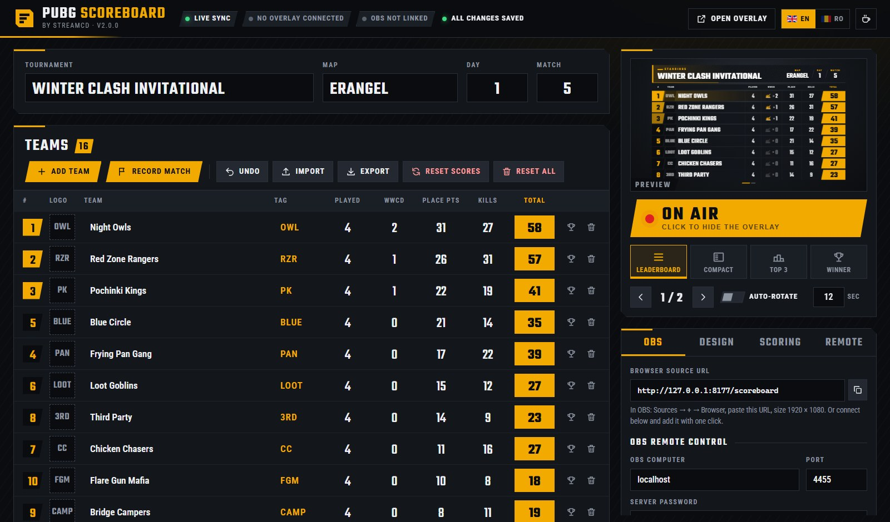

# PUBG Scoreboard

**Live tournament scoreboard and broadcast overlays for PUBG streams — built for OBS Studio.**

[](https://github.com/mmlTools/PUBGScoreboard/actions/workflows/ci.yml)
[](https://github.com/mmlTools/PUBGScoreboard/releases/latest)
[](LICENSE)

By [StreamCD](https://streamcd.net)

Run custom-room tournaments (PUBG, PUBG Mobile, or anything with placements and kills) and put the standings on stream. Type scores in the control panel; the overlay in OBS updates the same instant, animated.



| Winner Winner Chicken Dinner | Top 3 | Compact standings |
| :---: | :---: | :---: |
|  |  |  |



## Features

- **Four broadcast overlays** — full leaderboard, compact side standings, top-3 podium and a Chicken Dinner winner screen. Transparent background, 1920 × 1080, scales to any canvas.
- **Animated** — staggered entrances in five styles, counting numbers, rows that glide to their new rank with up/down markers, page rotation.
- **Instant sync over WebSocket** — the control panel and every overlay stay connected; a reload or reconnect always lands on the current state.
- **OBS Studio integration** — connect the panel to OBS (obs-websocket 5, built into OBS 28+) to switch scenes, add the overlay as a browser source with one click, refresh it, or toggle it in the current scene. The overlay replays its entrance when its scene goes live.
- **Remote control** — run the panel from a phone or second PC on your network, or trigger Show / Hide / Next from a Stream Deck with plain URLs.
- **Match recording** — enter each team's placement and kills; points are added with your scoring rules (SUPER 10-6-5-4-3-2-1-1, classic, or custom). PUBG esports tie-breaks.
- **Hard to break** — everything autosaves, destructive actions can be undone (25 steps), several panels can edit at once, configurations import/export as one file.
- **No dependencies** — plain PHP and vanilla JavaScript. No Composer, no npm, no build step. English and Romanian included.

## Quick start

### Windows — nothing to install

1. Download **`PUBGScoreboard-…-windows-portable.zip`** from the [latest release](https://github.com/mmlTools/PUBGScoreboard/releases/latest) and unzip it anywhere.
2. Double-click **`Start.bat`**. A console window opens (keep it open while you stream) and the control panel opens in your browser at `http://localhost:8080`.

The package includes its own PHP. If Windows reports a missing `VCRUNTIME140.dll`, install the [Microsoft Visual C++ Redistributable](https://aka.ms/vs/17/release/vc_redist.x64.exe).

### macOS / Linux, or your own PHP

Needs PHP 7.4 or newer — no extensions.

```sh
./start.sh                 # or: php server.php --open
```

| Option | Meaning |
| --- | --- |
| `--port=9000` | Use another port (default 8080). |
| `--lan` | Also accept connections from other devices on your network (see [Remote control](#remote-control)). |
| `--open` | Open the control panel in the default browser. |
| `--allow-host=name` | Also answer to this host name. By default the server only answers to `localhost`, IP addresses and the PC's own name, so other websites cannot reach it through DNS tricks. |

### Apache / XAMPP

Copy the folder into `htdocs` (a subfolder such as `/PUBGScoreboard/` is fine; `mod_rewrite` must be on). It works, but without the standalone server there is no WebSocket: the overlay falls back to polling about once a second. For instant updates use `Start.bat` / `php server.php` instead.

## Add the overlay to OBS

**One click:** in OBS open *Tools → WebSocket Server Settings*, enable the server, and copy the password from *Show Connect Info*. In the control panel's **OBS** tab enter it and press **Connect to OBS**, then **Add to scene**. The source is created at 1920 × 1080 and fitted to your canvas.

**By hand:** *Sources → + → Browser*, URL `http://localhost:8080/scoreboard`, width `1920`, height `1080`.

Overlay URL options:

| URL | Effect |
| --- | --- |
| `/scoreboard` | Follows the view selected in the control panel. |
| `/scoreboard?view=compact` | Pins this source to one view: `leaderboard`, `compact`, `podium` or `winner`. Use several browser sources to place views independently. |
| `/scoreboard?always=1` | Ignores the On Air switch (always visible). |
| `/scoreboard?preview=1` | Dark backdrop, for looking at it in a normal browser. |

## Running a tournament

1. **Add teams** — name, optional short tag and logo (click the logo box). Or press **Load demo tournament** to try things out.
2. After each match press **Record match**, enter placements and kills, **Save match**. Totals, matches played and chicken dinners update, the match number moves on, and the toast offers **Show Chicken Dinner** for the winner.
3. Prefer typing totals yourself? Edit any number directly in the table; *Enter* moves down a column. Turn off *Calculate totals automatically* in the **Scoring** tab to control the total column by hand.
4. Use **On Air**, the view buttons and the page arrows to decide what viewers see. The preview shows exactly what OBS shows.

Made a mistake? **Undo** restores the state before the last match, reset, import or team removal. **Export** saves the whole tournament — logos included — to one JSON file; **Import** loads it back (files from version 1.x are converted automatically).

## Remote control

**From a phone or another PC:** start with **`Start (remote control).bat`** (or `--lan`). The console and the panel's **Remote** tab show a link like `http://192.168.1.20:8080/?key=…`. Open it on the other device. Devices without the key can watch but not change anything; the streaming PC itself never needs it. To get a new key, delete `Autoload/server.php` and restart the server.

**From a Stream Deck, bot or script:** call these URLs (Stream Deck: *Website* action with *GET request in background*).

| URL | Action |
| --- | --- |
| `/api/cmd/show` · `/api/cmd/hide` · `/api/cmd/toggle` | Overlay visibility |
| `/api/cmd/next` · `/api/cmd/prev` | Page through the standings |
| `/api/cmd/view/winner` | Switch view (`leaderboard`, `compact`, `podium`, `winner`) and show it |

From another device add `?key=…`.

**For developers:** `GET /api/state` returns the tournament as JSON; `POST /api/action` with `{"action": "team.update", "payload": {…}}` changes it (see `Engine/Api.php` for the full list). A WebSocket at `/ws` sends `{"type": "state", …}` on every change and accepts the same actions.

## Your data

Everything lives in the `Autoload` folder next to the app: `tournament_data.json` (the tournament), `uploads/` (logos), `backups/` (undo history). To move to a new version or another PC, copy that folder or use Export / Import.

## Development

```
server.php        standalone server: HTTP + WebSocket on one port, PHP core only
index.php         front controller for Apache / php -S (HTTP polling instead of WebSocket)
Engine/           Store (state, validation, migration, undo) · Api (actions, access control) · Pages
Views/            control.html · overlay.html
Vendor/js/        core.js (sync, i18n) · control.js · overlay.js · obs.js (obs-websocket client)
Vendor/css/       control.css · overlay.css · fonts.css
Autoload/         translations.json + runtime data (git-ignored)
tests/            api.php · server.mjs · static.mjs
```

There is no build step: edit a file and reload.

```sh
php tests/api.php        # storage, scoring, migration, undo, access control
node tests/static.mjs    # JS syntax, translation coverage, OBS-browser CSS compatibility
node tests/server.mjs    # boots server.php and tests HTTP + WebSocket end to end (Node 22+)
```

**Translations** are in `Autoload/translations.json` (`key → { "en": …, "ro": … }`). To add a language, add its code to every entry, to `Store::LANGUAGES` in `Engine/Store.php`, and a button in `Views/control.html`.

**Releasing:** set `_VERSION` in `about.json`, commit, then `git tag v2.1.0 && git push origin v2.1.0`. The [release workflow](.github/workflows/release.yml) runs the tests, builds both packages, boots the Windows portable package on a Windows runner, and publishes the GitHub release with checksums.

## Credits and license

Licensed under the [GNU GPL v3](LICENSE). Fonts: [Teko](https://fonts.google.com/specimen/Teko) and [Roboto Condensed](https://fonts.google.com/specimen/Roboto+Condensed), SIL Open Font License (see `Vendor/fonts`). The Windows portable package bundles [PHP](https://www.php.net) under the PHP License.

This is a fan-made tool. It is not affiliated with, endorsed by or sponsored by KRAFTON, Inc. or PUBG. PUBG and PLAYERUNKNOWN'S BATTLEGROUNDS are trademarks of their respective owners.

If the scoreboard helps your stream, you can [buy me a coffee](https://www.paypal.com/donate/?hosted_button_id=ZKTLLYY9ADWYQ).
